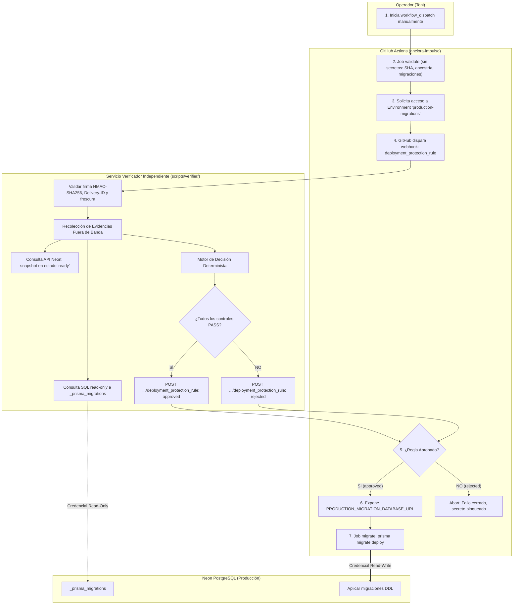

# Anclora Impulso — Resultado de la Implementación del Runner y Verificador D10

> **ESTADO GLOBAL: IMPLEMENTADO LOCALMENTE / REMOTO NO CONFIGURADO**
> **MIGRACIÓN Y EJECUCIÓN EN PRODUCCIÓN ESTRICTAMENTE NO AUTORIZADAS.**
> Fecha: 2026-10-12
> Autoridad: Instrucción actual de Toni (Nivel 1), decisión canónica `IMPULSO-AUTOMATED-MIGRATION-VERIFIER-2026-10-12` (Nivel 3).
> Árbol Git de evaluación: `development` @ `097840203807d0ae9ac4209cada26a6bd3f5adb6` (sincronizado con `origin/development`).

---

## 1. Resumen Ejecutivo y Veredicto

Se ha completado el diseño, la implementación técnica local y la suite de pruebas del **runner de migraciones de producción** y su **verificador automatizado independiente** (control D10) para Anclora Impulso.

### Veredicto Técnico:
- **Componente Local (Workflow + Guardas + Verificador + Tests)**: **`READY (100% PASS)`**
- **Componente Remoto GitHub (GitHub App + Environment + Secrets + Push)**: **`NOT READY / BLOQUEADO`**
- **Veredicto para Despacho en Producción**: **`NOT READY FOR PRODUCTION DISPATCH`**

> [!IMPORTANT]
> **Diferencia entre Readiness y Autorización de Migración**:
> Estar técnicamente preparado (`READY FOR WORKFLOW DISPATCH`) significa únicamente que el workflow y sus protecciones están listos en GitHub para una ejecución manual segura. **NO autoriza a migrar la base de datos de producción**. La migración real requiere una autorización expresa e independiente de Toni con fecha y ventana de mantenimiento, precedida por el backup y la verificación del ledger.

---

## 2. Arquitectura de Confianza y Componentes Implementados

### Diagrama de Fronteras y Flujo de Aprobación



### Componentes y Separación Estricta de Credenciales:
1. **Runner de Migraciones** ([`.github/workflows/production-migrations.yml`](.github/workflows/production-migrations.yml)):
   - Trigger exclusivo: `workflow_dispatch` (sin triggers automáticos).
   - Concurrencia serializada: `group: production-migrations`, `cancel-in-progress: false`.
   - Permisos mínimos: `contents: read`.
   - Validación estricta de inputs: SHA completo (regex `^[0-9a-f]{40}$`), ancestría contra `origin/$DEFAULT_BRANCH`, no atraso de migraciones.
   - Enmascaramiento de credenciales en logs públicos (`::add-mask::` para host, user, pass y dbName; rechazo de `-pooler`).
2. **Servicio Verificador Independiente** ([`scripts/verifier/`](scripts/verifier/)):
   - [webhook-security.ts](scripts/verifier/webhook-security.ts): Validación de firma HMAC-SHA256 con `timingSafeEqual`, prevención de replay con caché de `X-GitHub-Delivery` y validación de contexto.
   - [ledger-evaluator.ts](scripts/verifier/ledger-evaluator.ts): Evaluación de `_prisma_migrations` (compara checksums SHA-256, rechaza migraciones sin finalizar `finished_at=null`, rechaza rollbacks y valida estrictamente el hash canónico de la migración 5: `4becd718...`).
   - [backup-evaluator.ts](scripts/verifier/backup-evaluator.ts): Validación de snapshot en Neon (estado `ready`, pertenencia a la rama `main`, identificador seguro sin URLs y umbral de frescura configurable).
   - [decision-engine.ts](scripts/verifier/decision-engine.ts): Motor de decisión determinista fail-closed y auditoría.

---

## 3. Matriz de Requisitos, Evidencia y Estado de Gates

| # | Control / Requisito | Estado | Evidencia y Localización |
|---|---|---|---|
| **C01** | Triggers manuales y serialización del runner | **PASS** | `production-migrations.yml` (`workflow_dispatch`, `concurrency`). |
| **C02** | Sintaxis YAML y esquema GitHub Actions | **PARCIAL** | Parseo sintáctico validado con AST (`js-yaml`). `actionlint` no instalado en local. |
| **C03** | Validación estricta del commit SHA | **PASS** | Regex `^[0-9a-f]{40}$`, rechaza abreviados, tags, branches y mayúsculas. |
| **C04** | Ancestría Git y orden de migraciones | **PASS** | `git merge-base --is-ancestor`, consistencia de migración más reciente y `comm -13`. |
| **C05** | Atestaciones manuales obligatorias | **PASS** | Inputs requeridos `ledger_reviewed=true`, `backup_confirmed=true`, `backup_reference`. |
| **C06** | Enmascaramiento de logs y rechazo de pooler | **PASS** | Guardias de longitud (≥3 caracteres), rechazo de `\r`/`\n`, rechazo de `-pooler`. |
| **C07** | Fijación de dependencias | **PARCIAL** | Acciones fijadas a versión mayor (`@v4`), alineadas con el repo, no a SHA inmutable. |
| **C08** | Suite de pruebas del workflow | **PASS** | `scripts/support/test-production-migrations-workflow.sh` (**13/13 PASS**). |
| **C09** | Suite de pruebas del verificador | **PASS** | `scripts/verifier/run-verifier-tests.ts` (**20/20 PASS**). |
| **C10** | Existencia del Environment en GitHub | **FAIL / AUSENTE** | `gh api environments` confirma que `production-migrations` no existe en GitHub. |
| **C11** | Regla de Custom Deployment Protection | **FAIL / AUSENTE** | GitHub App no registrada ni configurada en el repositorio. |
| **C12** | Secreto `PRODUCTION_MIGRATION_DATABASE_URL` | **FAIL / AUSENTE** | No configurado en GitHub Actions. |
| **C13** | Workflow publicado en rama remota por defecto | **FAIL / AUSENTE** | Archivo local untracked. No commiteado ni pusheado a `origin/development`. |

### Estado del Ciclo de Vida:
```text
[1. DISEÑO COMPLETADO] ───────────▶ PASS (Formalizado en contratos .anclora/ y docs 24, 25)
[2. IMPLEMENTACIÓN LOCAL] ────────▶ PASS (Workflow y módulos de scripts/verifier/ completos)
[3. PRUEBAS LOCALES] ─────────────▶ PASS (33 pruebas en total: 20 verifier + 13 workflow)
[4. INTEGRACIÓN EN ENSAYO] ───────▶ PENDIENTE (Requiere registrar App y entorno sandbox)
[5. READINESS PARA DESPACHO] ─────▶ BLOQUEADO (Infraestructura remota y secrets ausentes)
[6. AUTORIZACIÓN DE MIGRACIÓN] ───▶ BLOQUEADO (Decisión operativa explícita de Toni pendiente)
[7. MIGRACIÓN EJECUTADA] ─────────▶ BLOQUEADO
[8. DESPLIEGUE VERIFICADO] ───────▶ BLOQUEADO
```

---

## 4. Registro de Decisiones Abiertas (Open Decisions)

| ID | Decisión | Opciones Disponibles | Compensaciones |
|---|---|---|---|
| **OD-01** | **Alojamiento del Verificador** | (A) Cloudflare Worker / Fly.io.<br>(B) Servicio ligero independiente en Render.<br>(C) Serverless Function en Vercel. | (A) Cero coste y aislamiento total.<br>(B) Centraliza en Render pero requiere servicio separado del backend.<br>(C) Riesgo de confusión de alcance con el frontend. |
| **OD-02** | **Creación del Snapshot en Neon** | (A) Manual en consola de Neon por Toni.<br>(B) Automatizado en job previo de CI.<br>(C) Script CLI local antes del despacho. | (A) Máxima seguridad, cero tokens con permisos DDL en GitHub Actions.<br>(B) Menor fricción, requiere token con permisos de snapshot en CI.<br>(C) Requiere credenciales en local. |
| **OD-03** | **Umbral de Frescura del Snapshot** | (A) 1 hora.<br>(B) 2 horas (valor por defecto).<br>(C) 4 horas / misma ventana. | (A) Menor margen de tiempo para preparar la ventana.<br>(B) Equilibrio estándar de mantenimiento.<br>(C) Mayor flexibilidad pero riesgo de divergencia de datos. |
| **OD-04** | **Pausa de Auto-Deploy en Render** | (A) Pausar `autoDeploy` manualmente en Render antes de mover `main`.<br>(B) Cambiar rama de seguimiento del backend en Render.<br>(C) Despliegues solo manuales. | (A) Procedimiento estándar del Runbook D10 v2.<br>(B) Desacopla promociones Git del backend.<br>(C) Control total con mayor sobrecarga operativa. |

---

## 5. Pruebas Ejecutadas y Evidencia Técnica

1. **Suite del Verificador Independiente**:
   ```bash
   npx tsx scripts/verifier/run-verifier-tests.ts
   ```
   - **Resultado**: `Total: 20 | Passed: 20 | Failed: 0`.
   - **Alcance**: Firma HMAC-SHA256, rechazo de replay por delivery ID, validación de contexto (entorno, repo, SHA), consistencia de checksums de migraciones, rechazo de checksum corrupto en migración 5, rechazo de migraciones sin finalizar, validación de snapshot y veto consultivo por IA fail-closed.

2. **Suite del Workflow de Migración**:
   ```bash
   ./scripts/support/test-production-migrations-workflow.sh
   ```
   - **Resultado**: `Total Passed: 13 | Total Failed: 0`.
   - **Alcance**: Parseo AST YAML, regex de inputs, rechazo de conexiones pooled (`-pooler`), rechazo de esquemas no-postgres, ancestría git en repositorio mock sintético y guardias de enmascaramiento.

3. **Verificación de Formato Git**:
   ```bash
   git diff --check
   ```
   - **Resultado**: 0 errores o advertencias de formato.

---

## 6. Pasos Manuales Pendientes para Toni

Para habilitar la operatividad del runner en un entorno de ensayo o producción:

1. **Crear el Environment en GitHub**:
   - En GitHub > *Settings > Environments*, crear `production-migrations`.
2. **Registrar la GitHub App**:
   - En GitHub > *Settings > Developer settings > GitHub Apps > New GitHub App*.
   - Nombre: `anclora-impulso-migration-verifier`.
   - Webhook URL: URL HTTPS del servicio verificador.
   - Permisos: `Actions: read`, `Deployments: read/write`.
   - Eventos: `Deployment protection rule`.
   - Descargar clave privada RSA (`.pem`) y guardarla en el gestor de secretos del verificador.
3. **Instalar la App y Habilitar la Regla**:
   - Instalar la App en `ToniIAPro73/anclora-impulso`.
   - En *Settings > Environments > production-migrations > Deployment protection rules*, activar la regla provista por la App.
4. **Configurar el Secreto de Conexión**:
   - Añadir `PRODUCTION_MIGRATION_DATABASE_URL` (conexión directa de Neon, sin `-pooler`) en los *Environment secrets* de `production-migrations`.
5. **Publicar el Workflow en Git**:
   - Autorizar `commit` y `push` de `.github/workflows/production-migrations.yml` a `origin/development`.

---

## 7. Estado Final del Árbol Git

- **Rama Activa**: `development`
- **`HEAD`**: `097840203807d0ae9ac4209cada26a6bd3f5adb6` (sincronizado con `origin/development`).
- **Archivos Modificados en el Árbol de Trabajo**:
  - [`.anclora/AGENT_PROJECT_CONTEXT.md`](.anclora/AGENT_PROJECT_CONTEXT.md)
  - [`.anclora/AOS_ADOPTION.md`](.anclora/AOS_ADOPTION.md)
  - [`.anclora/PRODUCTION_RUNTIME.md`](.anclora/PRODUCTION_RUNTIME.md)
  - [`sdd/features/impulso-pilot-review-package/INDEX.md`](sdd/features/impulso-pilot-review-package/INDEX.md)
  - [`scripts/verifier/backup-evaluator.ts`](scripts/verifier/backup-evaluator.ts)
  - [`sdd/features/impulso-pilot-review-package/24-production-migrations-runner-readiness-report-v1.md`](sdd/features/impulso-pilot-review-package/24-production-migrations-runner-readiness-report-v1.md)
  - [`sdd/features/impulso-pilot-review-package/25-d10-automated-migration-verifier-report-v1.md`](sdd/features/impulso-pilot-review-package/25-d10-automated-migration-verifier-report-v1.md)
  - [`RESULTADO-IMPLEMENTACION-D10.md`](RESULTADO-IMPLEMENTACION-D10.md) (este documento)
- **Archivos Untracked Conservados**:
  - `.github/workflows/production-migrations.yml`
  - `scripts/support/test-production-migrations-workflow.sh`
  - `scripts/verifier/` (`webhook-security.ts`, `ledger-evaluator.ts`, `decision-engine.ts`, `run-verifier-tests.ts`)
  - Informes previos 18 al 23 y test unitario `admin-user-ids-parser.test.ts`.
  - Symlink `.anclora/global` conservado intacto (marcado como borrado en working tree sin tocar).
- **Invariante de Seguridad**: **No se ha realizado ningún commit ni push.**

---
## Nota de revisión (2026-10-12)
Este informe consolidado debe leerse junto con el addendum de `sdd/features/impulso-pilot-review-package/25-d10-automated-migration-verifier-report-v1.md`.
Correcciones de estado: (1) del verificador solo están implementadas las **reglas de decisión** (20 pruebas); servicio receptor, cliente de BD,
cliente Neon, firma de la App y aprobación **no existen**; (2) hay hallazgos abiertos de diseño (payload del webhook, SHA evaluado frente a SHA
migrado, hash del workflow, ledger vacío, replay compartido, sustitución de la revisión humana). **RELEASE NO AUTORIZADO.**
