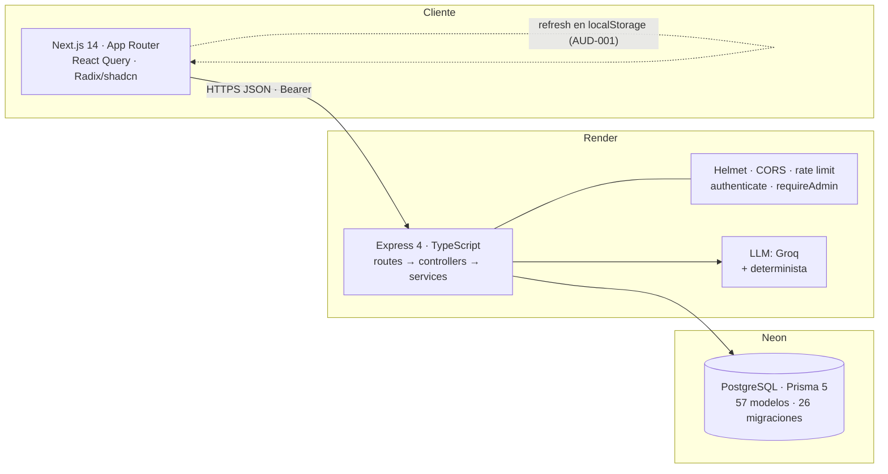
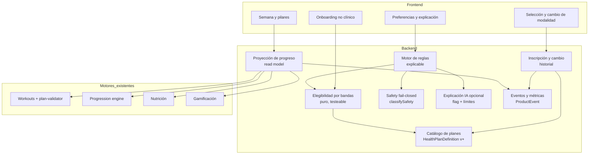
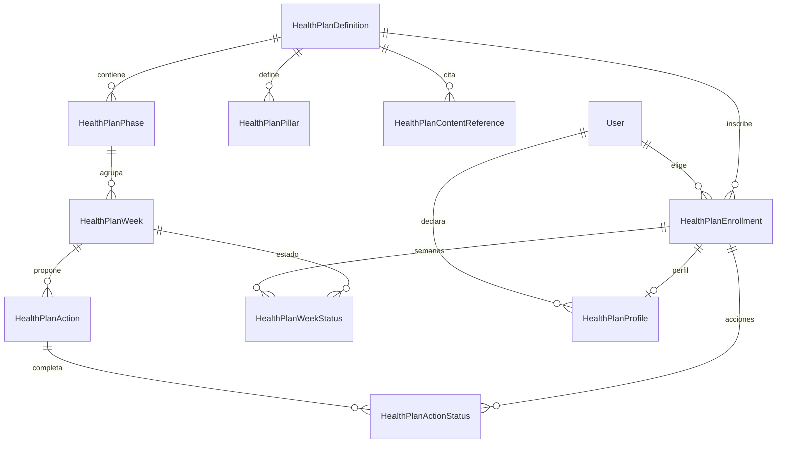
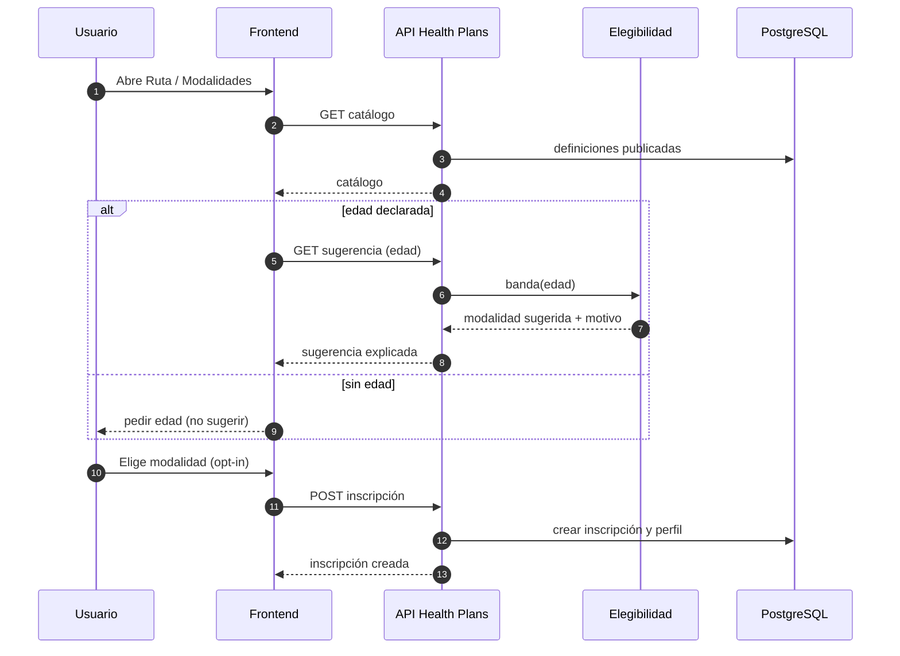
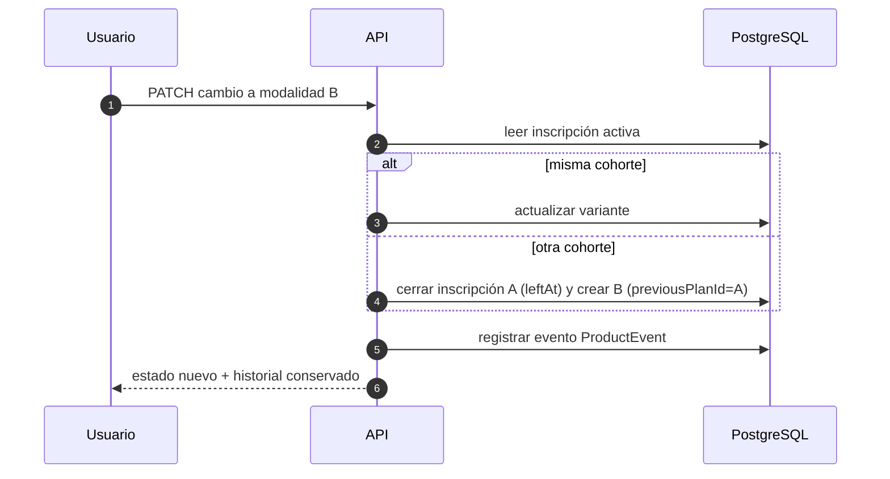
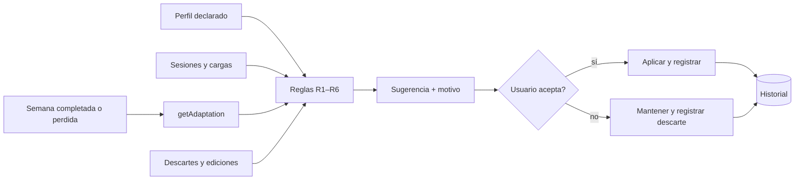
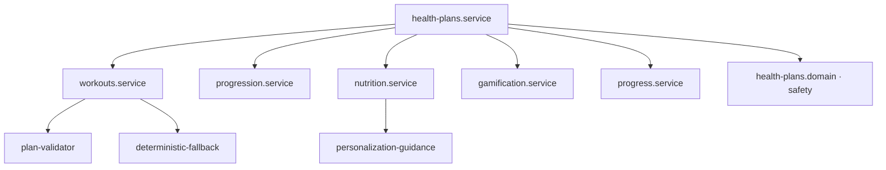

# 08 — Arquitectura objetivo y diagramas

> **Commit:** `0e0b897`. **Fecha:** 2026-11-09.
> Regla: lo que aparece como **propuesto** no existe. Los diagramas distinguen situación actual y objetivo.

---

## 1. Principios

1. **Reutilizar motores** (workouts, progression, nutrition, gamification, progress). Health Plans **orquesta**, no duplica.
2. **Configuración en datos** (catálogo versionado) antes que código por modalidad.
3. **Migraciones aditivas** y compatibles con datos existentes; sin borrados ni backfill destructivo (`SPEC §7.2`).
4. **Opt-in** y **sin inferencias** de capacidad por edad o sexo.
5. **Fail-closed** en seguridad: ante la duda, no se recomienda entrenamiento de carga.
6. **Un único entorno de datos** según contrato (producción) hasta que Toni decida otra cosa; ningún cambio asume infraestructura compartida entre productos.

---

## 2. Arquitectura actual

Fuentes: `PRODUCTION_RUNTIME.md` §2–§3; `backend/src/app.ts`; `backend/src/services/llm/`.

---

## 3. Arquitectura objetivo

### 3.1 Clasificación de componentes

| Componente | Clase | Estado | Notas |
|---|---|---|---|
| Catálogo de planes (`HealthPlanDefinition`, `Phase`, `Week`, `Action`, `Pillar`) | **Imprescindible** | Existe | Añadir cohorte y variante (`TASK-017`) |
| Elegibilidad por bandas | **Imprescindible** | Propuesto | `isInCohort` ya existe; corregir `null` (`TASK-008`, `TASK-020`) |
| Inscripción y cambio | **Imprescindible** | Parcial (inscripción) | Cambio con historial (`TASK-023`) |
| Safety | **Imprescindible** | Existe | `classifySafety` |
| Motor de reglas | **Imprescindible** | Propuesto | `TASK-026` |
| Proyección de progreso | **Imprescindible** | Parcial | Reutilizar lecturas de progreso y sesiones |
| Onboarding no clínico | Opcional de primera versión | Propuesto | `TASK-025` |
| Explicación IA | Opcional | Propuesto | `TASK-029`, tras reglas |
| Panel administrativo de planes | Futuro | Propuesto | Solo si Toni lo necesita; hoy el catálogo se siembra |
| Motor de recomendaciones con ML | Futuro | Descartado por ahora | Sin datos suficientes |
| Interfaz de comparación de modalidades | Futuro | Propuesto | Útil para 10 modalidades (`TASK-022`) |

---

## 4. Modelo de datos propuesto

Estado actual: las entidades existen (CONFIRMADO en `schema.prisma:939-1120`).

### 4.1 Cambios propuestos (aditivos)

| Entidad | Campo nuevo | Tipo | Motivo | Compatibilidad |
|---|---|---|---|---|
| `HealthPlanDefinition` | `cohortKey` (P01–P10 o `RV-50-60`) | String, único por `key`+versión | Catálogo de 10 | Filas existentes conservan valores |
| `HealthPlanDefinition` | `variantKey` (`M`, `F`, `NEUTRAL`) | String? | Variante de contenido | Nullable |
| `HealthPlanDefinition` | `ageMin`, `ageMax` (`ageMax` nullable) | Int | Bandas sin solape | Ruta Vital existente: `50`, `60` (decisión 06 §3) |
| `User` | `sexAtBirth`, `genderIdentity` | String? | Separación de atributos | Campo `sex` se mantiene |
| `HealthPlanEnrollment` | `previousPlanId` | String? | Historial de cambio | Nullable |
| `HealthPlanDefinition` | `consentVersion` | String? | Consentimiento | Nullable |

Migraciones: una por bloque, con prueba de adelanto y de restauración (`SPEC §7.2`).

---

## 5. Flujos

### 5.1 Selección inicial del plan

### 5.2 Cambio de modalidad

### 5.3 Personalización progresiva

### 5.4 Relaciones entre servicios

Regla: ningún servicio de la flecha inferior importa de `health-plans.*` (no hay dependencia circular). Esta regla se verificará con un test de importaciones (`TASK-020`).

---

## 6. Estrategia de evolución

| Pregunta | Respuesta |
|---|---|
| ¿Qué conservar? | Motores de workouts, progression, nutrition, gamification, progress; validadores Zod; safety de dominio; esquema de Health Plans |
| ¿Qué modificar? | Elegibilidad (`null`), `User` (atributos), catálogo (cohorte y variante), refresh token (AUD-001) |
| ¿Qué añadir? | Onboarding no clínico, selección y cambio, motor de reglas, proyección de progreso, explicación opcional |
| ¿Qué resolver antes? | AUD-006 (migración en producción), AUD-003 (legal), AUD-001 (refresh), AUD-005 (tipos) |
| ¿Cómo incrementar? | Feature flags por modalidad; una modalidad piloto (P07) antes de las demás |
| ¿Cómo evitar regresiones? | Tests de caracterización antes de partir servicios (`TASK-014`); E2E de la ruta (`TASK-013`) |
| ¿Cómo mantener datos? | Migraciones aditivas; nada se borra; `previousPlanId` guarda historia |
| ¿Qué pruebas? | Unitarias de bandas y safety; integración en CI con Postgres de test; E2E con usuario QA dedicado |

---

## 7. Restricciones de despliegue

- Las migraciones se aplican **antes** del backend que las usa (CONFIRMADO en `PRODUCTION_RUNTIME.md` §4).
- El backend se despliega manualmente en Render; no hay auto-deploy.
- Frontend en Vercel; producción ligada a `main`.
- Local = producción por contrato; ver AUD-014 y decisión de Toni.
