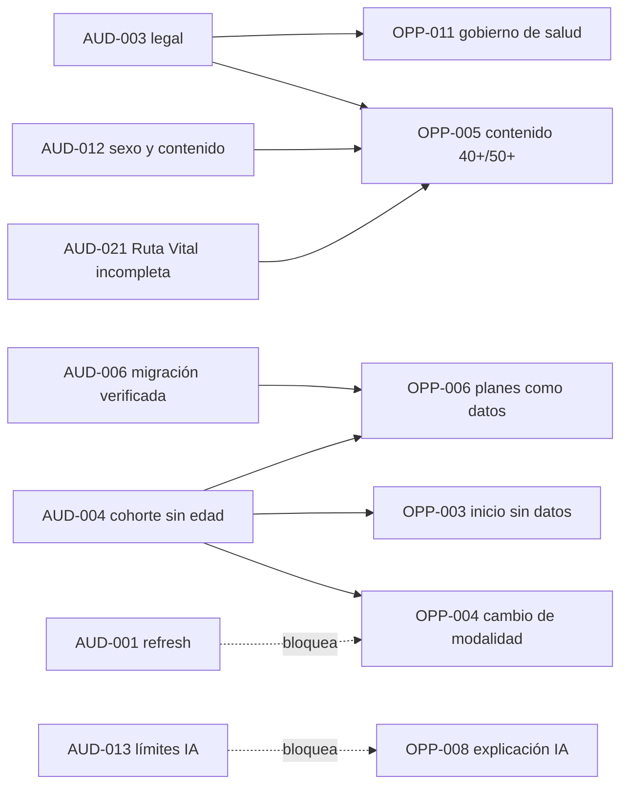

# 09 — Registro de hallazgos y oportunidades

> **Commit:** `0e0b897`. **Fecha:** 2026-11-09. Registro único de la auditoría.
> Estados: **CONFIRMADO** · **INFERIDO** · **HIPÓTESIS** · **NO VERIFICADO**.
> Severidad: **Crítica · Alta · Media · Baja**. Esfuerzo: **S · M · L · XL**.

---

## 1. Hallazgos (`AUD-xxx`)

| ID | Categoría | Título | Estado | Severidad | Esfuerzo | Dependencias | Tarea |
|---|---|---|---|---|---|---|---|
| AUD-001 | Seguridad | Refresh token en JSON y `localStorage` | CONFIRMADO | Alta | M | — | TASK-002 |
| AUD-002 | Seguridad | Secretos JWT con valor por defecto; bloqueo solo con `NODE_ENV=production` | CONFIRMADO (código) / NO VERIFICADO (despliegue) | Media | S | — | TASK-006 |
| AUD-003 | Legal / seguridad | Sin cláusula de menores, de salud ni de consentimiento; registro sin edad | CONFIRMADO (ausencia) / HIPÓTESIS (norma) | Alta | M | — | TASK-003 |
| AUD-004 | Producto / datos | Cohorte 50–60 considera elegible a quien no tiene edad (`isInCohort` → `true`) | CONFIRMADO | Media | S | — | TASK-008, TASK-020 |
| AUD-005 | Técnica | 4 errores de tipos en backend por cliente Prisma no regenerado | CONFIRMADO (reproducido); causa INFERIDO | Media | S | — | TASK-005 |
| AUD-006 | Operación / datos | Migración `add_health_plans` aplicada en producción; el gate P1 la describe como "development database" (error documental) | **CONFIRMADO** (resuelto) | Baja | S | — | TASK-001 (cierre documental) |
| AUD-007 | Supply chain | Dependencias sin uso (`@supabase/*`, `openai`, `anthropic`, `psycopg2-binary`) y 14 `latest` | CONFIRMADO | Media | S | — | TASK-004 |
| AUD-008 | Documentación | Métricas de tests desfasadas (23+, 78, 39, 41 frente a 150 y 114 medidas hoy) | CONFIRMADO | Baja | S | — | TASK-011 |
| AUD-009 | Documentación / estrategia | Business doc afirma GPT-4, "100 ejercicios validados por profesionales", precios | CONFIRMADO (GPT-4) / NO VERIFICADO (validación) | Media | S | — | TASK-011 |
| AUD-010 | Documentación | CLAUDE.md dice dashboard sin protección, build sin checks y refresh en cookie; no es así | CONFIRMADO | Baja | S | — | TASK-011 |
| AUD-011 | Seguridad | Carpeta estática `/dashboard` pública (datos detrás de admin) | CONFIRMADO | Baja | S | — | TASK-007 |
| AUD-012 | Producto / contenido | Sexo binario; textos 40+ por sexo con términos clínicos sin proveniencia | CONFIRMADO | Alta | M | TASK-003 | TASK-009, TASK-018 |
| AUD-013 | Seguridad clínica / producto | Límites de entrenamiento IA `PENDING_PROFESSIONAL_REVIEW` | CONFIRMADO | Alta | M | — | TASK-010 |
| AUD-014 | Operación | Desarrollo local conectado por diseño a la base de producción | CONFIRMADO (contrato) | Alta | S | — | TASK-012 |
| AUD-015 | Técnica | `nutrition.service.ts` de 1749 líneas con varias responsabilidades | CONFIRMADO | Media | L | — | TASK-014 |
| AUD-016 | Técnica | Componentes de 600–900 líneas (`dashboard-content.tsx`) | CONFIRMADO | Baja | M | — | TASK-015 |
| AUD-017 | Calidad | 34 usos de `any` | CONFIRMADO | Baja | M | — | TASK-016 |
| AUD-018 | Testing | Sin E2E ni test de UI para Ruta Vital; 6 specs E2E sin planes | CONFIRMADO | Media | M | — | TASK-013 |
| AUD-019 | UX | Hallazgos UX-01 a UX-11 con gate declarado pero sin verificar en navegador | INFERIDO | Media | M | — | TASK-013 |
| AUD-020 | Documentación / arquitectura | Hosting y rutas contradictorias entre SPEC, CLAUDE.md y contrato; artefactos de auditoría en la raíz | CONFIRMADO | Baja | S | — | TASK-011 |
| AUD-021 | Producto | Ruta Vital: solo 4 semanas plantilla frente a 24 semanas declaradas | CONFIRMADO | Media | L | TASK-009 | TASK-021 |
| AUD-022 | Dependencia | Un único proveedor LLM (Groq) con respaldo determinista | CONFIRMADO | Baja | M | — | Decisión (no tarea) |
| AUD-024 | Seguridad (crítica) | `app/auth/login/page.tsx` (Server Component) lee `USER_TEXT`/`PASS_TEXT` del entorno y, si `UTILIZAR_USER_TEXT === "true"`, serializa email y contraseña en el HTML de `/auth/login`. Introducido en `adf0f5b`, presente en `main` y `production` | **CONTENIDA en producción** (2026-11-10, verificación de solo lectura; variables eliminadas en Vercel). Riesgo residual de la contraseña **aceptado por el propietario** (sin rotación; condiciones: cuenta sólo de pruebas, sin reutilización en otros servicios, sin privilegios sensibles). **Cierre definitivo pendiente del despliegue del Paquete A** — ver `17` §14 y §14.6 | **Crítica** | S | — | Paso 0 y 0b de `16_PHASE0_ACCEPTANCE_REVIEW.md` |
| AUD-023 | Seguridad / operación | El proyecto Vercel del frontend tiene inyectadas las credenciales de la base de producción, aunque el frontend no accede a la BD (la BD sí la usa el backend en Render) | CONFIRMADO (variables presentes, por nombre) / INFERIDO (innecesario) | Media | S | — | TASK-012 |

### 1.1 Detalle por hallazgo

Cada entrada indica evidencia, impacto, KPI y validación. La evidencia completa (rutas y líneas) está en los documentos 01–03.

**AUD-001 · Refresh token en `localStorage`**
- **Evidencia:** `backend/src/controllers/auth.controller.ts:88` devuelve `refreshToken` en JSON; `lib/api/auth.ts:33` y `lib/contexts/auth-context.tsx:181,191` lo guardan en `localStorage`.
- **Impacto:** un XSS que lea `localStorage` obtiene un refresh de 30 días. La CSP reduce la probabilidad, no el impacto.
- **Recomendación:** cookie `httpOnly`, `secure`, `sameSite=lax` (ya existe el patrón en `oauth.controller.ts:27-29`); mantener rotación; ajustar logout.
- **KPI:** 0 claves `refreshToken` en `localStorage` tras el despliegue.
- **Validación:** test de integración de login/refresh/logout con cookie; comprobación de que el frontend no lee el token.

**AUD-002 · Secretos por defecto**
- **Evidencia:** `backend/src/config/env.ts:39,41` define valores por defecto; `env.ts:138-143` solo los bloquea con `NODE_ENV=production`.
- **Recomendación:** fallar al arrancar si el secreto es el valor por defecto en cualquier entorno distinto de `test`.
- **KPI:** arranque falla en cualquier entorno sin secretos reales.
- **Validación:** test unitario de configuración; verificación de Toni de las variables en Render (sin exponer valores).

**AUD-003 · Menores, salud y consentimiento**
- **Evidencia:** `components/legal-document.tsx` y `app/privacy|terms|legal` sin coincidencias de "menor/minor/edad"; `validators.ts:4-8` registro sin edad; `validators.ts:18` acepta 14–100.
- **Impacto:** requisito legal y de confianza antes de lanzar cohortes por edad. **Contexto declarado por el propietario (2026-11-10):** los datos de la base Neon son datos propios de prueba, no clientes en explotación comercial. Conteo aproximado (`pg_stat_user_tables`): ≈565 usuarios, 557 con dominio `example.com`, 5 inscripciones en `health_plan_enrollments`. Esta declaración no sustituye los controles: el requisito legal previo al lanzamiento por edad sigue vigente.
- **Recomendación:** revisión legal; bloqueo de planes para menores; consentimiento específico para datos de salud (ver 06 §4).
- **KPI:** texto legal aprobado; 0 menores inscritos en planes con salud antes de la aprobación.
- **Validación:** revisión escrita de asesoría legal; test que bloquea la inscripción de `age < 18`.

**AUD-004 · Cohorte sin edad**
- **Evidencia:** `backend/src/services/health-plans.domain.ts:49` (`age == null || …`), usado en `health-plans.service.ts:129`.
- **Recomendación:** devolver `false` si no hay edad; pedir edad antes de sugerir.
- **KPI:** 0 inscripciones sin edad registrada.
- **Validación:** tests de límites (`17, 18, 29, 30, 39, 40, 49, 50, 59, 60, null`).

**AUD-005 · Errores TS backend**
- **Evidencia:** `tsc --noEmit` en `backend/` reproducido: `oauth-handoff.service.ts` líneas 30, 70, 76, 105.
- **Causa probable:** cliente Prisma generado antes de `20261012090000_add_oauth_handoffs` (INFERIDO). No se ejecutó `prisma generate` (escribe en `node_modules`).
- **Recomendación:** regenerar en CI antes de `tsc`; el gate local debe usar el cliente actual.
- **KPI:** `tsc --noEmit` backend sin errores en CI.

**AUD-006 · Estado de la migración de Health Plans (resuelto en BD; discrepancia documental)**
- **Evidencia:** `docs/roadmap/impulso-post-ux-health/P1-FINAL-GATE-REPORT.md` mencionaba "applied … to configured development database", mientras que `.anclora/PRODUCTION_RUNTIME.md` §3 y §9 establece `LOCAL_RUNTIME_MODEL=PRODUCTION_BACKED` y `DO_NOT_CREATE_DEVELOPMENT_DATABASE=true`. Verificación de solo lectura en Neon (2026-11-09, vía Vercel CLI): las 58 tablas de `public` incluyen las 10 `health_plan_*` y `_prisma_migrations` registra `20260914130000_add_health_plans` como terminada sin rollback.
- **Impacto:** sin impacto operativo en BD (la migración ya está en producción); quedaba únicamente la discrepancia documental entre el informe del gate P1 y el contrato de runtime.
- **Recomendación:** aclarar la redacción en `P1-FINAL-GATE-REPORT.md` y dejar constancia en `.anclora/PRODUCTION_RUNTIME.md` §12 (`TASK-001`).
- **KPI:** estado de migraciones de producción documentado y consistente entre gate y contrato.
- **Validación:** revisión documental de `P1-FINAL-GATE-REPORT.md` y `.anclora/PRODUCTION_RUNTIME.md`.

**AUD-007 · Dependencias**
- **Evidencia:** `package.json` raíz; `grep` de importaciones sin coincidencias en `app components lib hooks backend/src middleware.ts scripts ai e2e`.
- **Recomendación:** eliminar; fijar versiones exactas (`pnpm` con lockfile).
- **KPI:** 0 dependencias sin importar; 0 `latest`.

**AUD-008 · Métricas de tests**
- **Evidencia:** CLAUDE.md ("23+ tests"); gates P0 (78/39), P7 (78/41); medición de hoy: 150 frontend, 114 backend unitarios, 31 suites de integración.
- **Recomendación:** actualizar documentación con cifras reproducibles.

**AUD-009 · Promesas de negocio**
- **Evidencia:** `docs/business/EXECUTIVE-SUMMARY.md` (GPT-4; "100 ejercicios validados por profesionales certificados"; freemium con cifras); sin `gpt-4` en código; `env.ts:94-96` (Groq).
- **Recomendación:** retirar o marcar como objetivo; no citar externamente sin verificación.

**AUD-010 · Documentación de CLAUDE.md**
- **Evidencia:** `dashboard.routes.ts:13` (admin); `next.config.mjs` sin `ignoreBuildErrors`; `PRODUCTION_RUNTIME.md` (refresh no documentado como cookie, pero `auth.controller.ts:88` lo contradice).

**AUD-011 · `/dashboard` público**
- **Evidencia:** `backend/src/app.ts:77`; `backend/public/dashboard.html`.
- **Recomendación:** retirar del build de producción o protegerlo con la misma autenticación admin.

**AUD-012 · Sexo binario y contenido por sexo**
- **Evidencia:** `validators.ts:17,290` (`male|female`); `forty-plus-guidance.ts:21-29` (perimenopausia, menopausia, grasa visceral) sin fuente.
- **Recomendación:** proveniencia y variante configurable; separación `sexAtBirth` / `genderIdentity` (07 §3).
- **KPI:** 100 % de afirmaciones de contenido con fuente.

**AUD-013 · Límites de IA**
- **Evidencia:** `backend/src/services/workouts/plan-limits.ts:1-15` (`PENDING_PROFESSIONAL_REVIEW`); `DEFAULT_PLAN_LIMITS` con `reviewStatus` no revisado.
- **Recomendación:** revisión profesional y sustitución por valores revisados; **no ampliar** los límites sin revisión.

**AUD-014 · Local contra producción**
- **Evidencia:** `.anclora/PRODUCTION_RUNTIME.md` §3 y §9 (`LOCAL_RUNTIME_MODEL=PRODUCTION_BACKED`); `backend/tests/support/default-integration-guard.ts` (existe; eficacia verificada mediante tests unitarios de `db-target`).
- **Recomendación:** decisión de Toni; mientras tanto, reforzar guardas de integración para rechazar cualquier host que no sea loopback y documentar en el contrato.

**AUD-015 · `nutrition.service.ts`**
- **Evidencia:** 1749 líneas (`wc -l`).
- **Recomendación:** partir por subdominios con tests de caracterización previos.

**AUD-016 · Componentes grandes**
- **Evidencia:** `components/dashboard-content.tsx` 875 líneas; `progress-tracker.tsx` 666; `workout-generator.tsx` 567.

**AUD-017 · `any`**
- **Evidencia:** 34 coincidencias de `: any` / `as any` en `backend/src`, `app`, `components`, `lib`.

**AUD-018 · Testing de planes**
- **Evidencia:** `backend/tests/integration/health-plans.test.ts` (no ejecutado); no hay test de `app/health-plans` ni de `components/health-plan-*`; `e2e/` contiene 6 specs sin planes.

**AUD-019 · UX sin verificar**
- **Evidencia:** SPEC §5; gates P2–P7 declaran PASS sin reproducción en navegador.

**AUD-020 · Contradicciones documentales**
- **Evidencia:** SPEC §2.2 ("Render/Railway según configuración"); CLAUDE.md ("Railway/Render"); `PRODUCTION_RUNTIME.md` §2 (Render). `RESULTADO-IMPLEMENTACION-D10.md` y `docs/audits/*.py` en lugares poco obvios.

**AUD-021 · Ruta Vital incompleta**
- **Evidencia:** `health-plans.service.ts` (siembra semanas 1, 5, 13 y 25); `getPhaseForWeek` mapea hasta la semana 24+ (`health-plans.domain.ts:52-57`).
- **Recomendación:** contenido de 24 semanas revisado; no publicar fases sin contenido.

**AUD-022 · Proveedor único de IA**
- **Evidencia:** `services/llm/index.ts` (solo `groq`); `deterministic-fallback.ts`.
- **Recomendación:** mantener; evaluar segundo proveedor solo si hay incidencias de disponibilidad (NO VERIFICADO).

**AUD-023 · Credenciales de Neon en el proyecto Vercel del frontend**
- **Evidencia:** listado de variables de entorno en Vercel (`POSTGRES_*`, `DATABASE_URL`) frente a ausencia de referencias a Prisma o BD en `app/`, `lib/`, `components/`, `hooks/` y `middleware.ts` (`app/api/` solo contiene `csp-report` y `logs`).
- **Impacto:** superficie innecesaria de credenciales de producción en un despliegue que solo sirve el frontend y se comunica con el backend de Render vía HTTPS.
- **Recomendación:** revisar en el dashboard de Vercel si la integración con Neon puede desvincularse del proyecto del frontend manteniendo únicamente las variables necesarias (`NEXT_PUBLIC_API_URL`, etc.).
- **KPI:** 0 variables `DATABASE_URL` / `POSTGRES_*` innecesarias en el proyecto Vercel del frontend.

---

## 2. Oportunidades (`OPP-xxx`)

Las oportunidades completas (problema, público, evidencia, alternativas, valor, impacto, dificultad, riesgos, KPI) están en `05_DIFFERENTIATION_STRATEGY.md`. Resumen:

| ID | Categoría | Título | Estado | Relación con hallazgos | Tarea |
|---|---|---|---|---|---|
| OPP-001 | Paridad | Siguiente acción en un solo lugar | CONFIRMADO (UX-07 documentado) | — | TASK-028 (parcial) |
| OPP-002 | Paridad | Ajuste por recuperación y días perdidos | CONFIRMADO (dominio) | AUD-021 | TASK-026 |
| OPP-003 | Mejora | Ruta de inicio sin datos previos | CONFIRMADO (ausencia de campos en registro) | AUD-004 | TASK-025 |
| OPP-004 | Mejora | Cambio de modalidad sin perder historial | CONFIRMADO (ausencia) | AUD-004 | TASK-023 |
| OPP-005 | Diferenciador | Contenido 40+/50+ con proveniencia visible | CONFIRMADO (modelo) | AUD-012, AUD-021 | TASK-009, TASK-021 |
| OPP-006 | Diferenciador | Planes como datos versionados | CONFIRMADO (modelo) | AUD-006, AUD-004 | TASK-017 a TASK-020 |
| OPP-007 | Diferenciador | Recomendación explicable y reversible | CONFIRMADO (P4) | AUD-019 | TASK-026 |
| OPP-008 | Innovación | Explicación en lenguaje natural | HIPÓTESIS | AUD-022 | TASK-029 |
| OPP-009 | Innovación | Readiness desde wearables | NO VERIFICADO | — | Aplazada |
| OPP-010 | Innovación | Vista familiar / pareja | HIPÓTESIS | — | Aplazada |
| OPP-011 | Ventaja sostenible | Gobierno de contenido y de salud | CONFIRMADO (parcial) | AUD-003 | TASK-003, TASK-009 |
| OPP-012 | Ventaja sostenible | Ecosistema Anclora | NO VERIFICADO | — | Fuera de alcance |
| OPP-013 | Ventaja sostenible | Español nativo para 50+ | HIPÓTESIS | — | TASK-027 (investigación) |

---

## 3. Relación entre hallazgos y oportunidades

---

## 4. Qué debe resolverse antes de desarrollar personalización

| Antes de | Debe resolverse | Por qué |
|---|---|---|
| Cualquier inscripción por edad | AUD-003, AUD-004 | Base legal y elegibilidad con edad obligatoria (AUD-006 ya verificado en Neon) |
| Pantallas con datos de salud nuevos | AUD-001, AUD-003 | Seguridad de sesión y base legal |
| Onboarding con sexo y edad | AUD-012 | Tratamiento de atributos sensibles |
| Cambio de modalidad | AUD-004 | Consistencia de elegibilidad e inscripciones |
| Explicación con IA | AUD-013, AUD-022 | Límites revisados y coste controlado |
