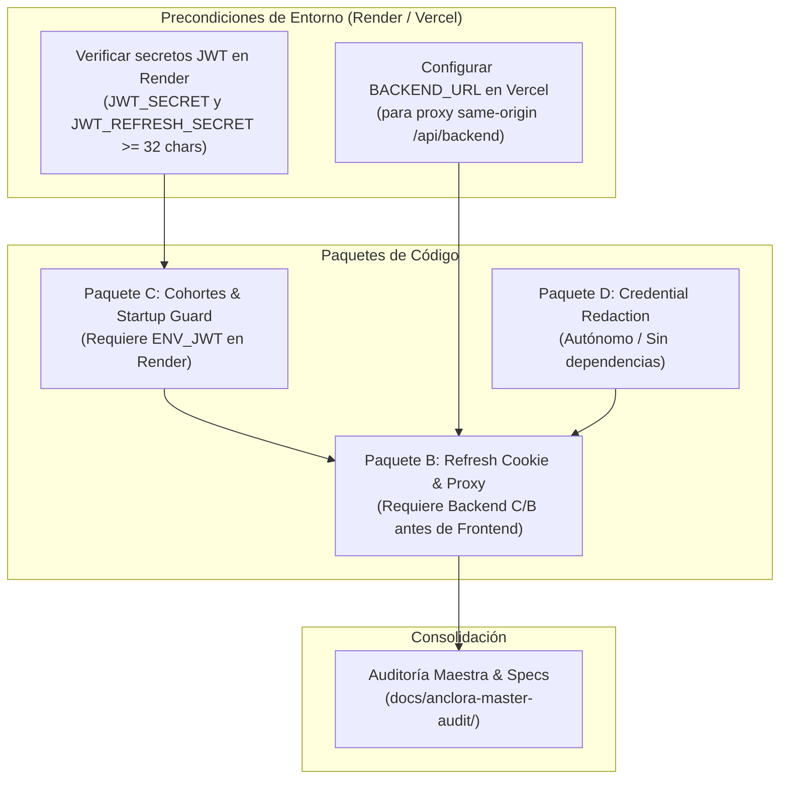
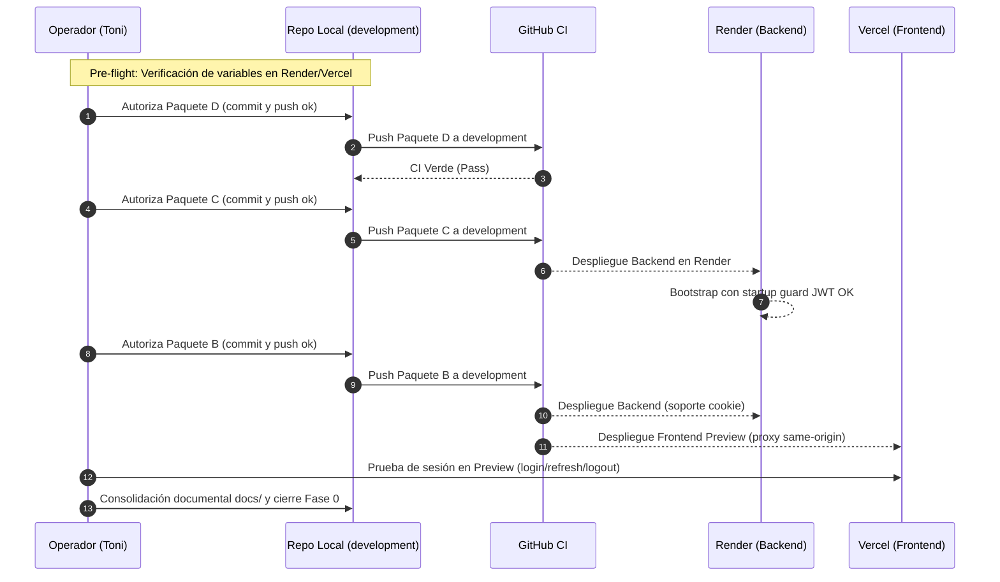

# 21 — Consolidación independiente de Fase 0: Inventario, Dependencias y Plan de Integración

> **[HISTÓRICO — FASE 0 CERRADA (2026-11-11)]** Documento conservado como registro histórico del proceso de validación e integración de la Fase 0. Todos los paquetes y controles descritos están ya integrados en `development` (`af5f38d` Paquete A, `662e1e7` Paquete D, `4093beb` Paquete C, `f791d2b` Paquete B y `249d861` Promotion Gate con Auto-Deploy Render).

**Fecha de evaluación:** 2026-11-10  
**Evaluador:** Antigravity (evaluación independiente)  
**Repositorio / Rama:** `anclora-impulso` / `development`  
**HEAD de referencia:** `af5f38d` (`fix(auth): stop exposing login credentials from environment variables (AUD-024)`)  
**Estado de origin/development:** Sincronizado con HEAD (`af5f38d`)  
**Marco de gobernanza:** AOS Lean (`AOS_LEAN_FAST_PATH.md`, D-2026-0052, D-2026-0053 prop.)  
**Alcance de ejecución:** Solo análisis e informe técnico. Sin commits, sin pushes, sin promociones, sin despliegues y sin mutaciones de base de datos.

---

## 1. Resumen ejecutivo

El estado actual del repositorio `anclora-impulso` presenta **63 rutas pendientes** en Source Control sobre el commit publicado `af5f38d`.
El **Paquete A (AUD-024)** ya fue integrado con éxito en `development` y cuenta con CI y Preview validados en `af5f38d`.
Los cambios funcionales pendientes corresponden a tres paquetes perfectamente delimitados y sin colisiones de código entre sí:

1. **Paquete B (TASK-002 — 16 rutas):** Almacenamiento seguro de refresh token en cookie `HttpOnly` y configuración de proxy same-origin en Next.js.
2. **Paquete C (FASE0-RESTO — 11 rutas):** Guardias de cohortes P01–P10, startup guard para secretos JWT fuera de test, endurecimiento de loopback para base de datos y reubicación canónica de tests unitarios de dominio.
3. **Paquete D (CREDENTIAL-REDACTION — 5 rutas):** Utilidad centralizada de redacción de credenciales en logs y suites de sondeo sintético QA.

Las **31 rutas restantes** corresponden al corpus documental de la auditoría maestra (22 documentos), artefactos de respaldo de parches (7 archivos) y una propuesta de compuerta de promoción (2 archivos).

**Conclusión de gobernanza e integración:**  
Fase 0 continúa **ABIERTA**. No existen migraciones de base de datos pendientes (el esquema de Neon cuenta con las 58 tablas públicas verificadas y sin rollbacks).
El principal bloqueo técnico antes de desplegar el backend es la confirmación por el propietario de que Render tiene configuradas las variables `JWT_SECRET` y `JWT_REFRESH_SECRET` con una longitud mínima de 32 caracteres y valores distintos (requisito estricto del Paquete C).
La propuesta de compuerta de promoción en `gate.mjs` no debe introducirse localmente en Impulso, ya que entraría en conflicto con el estándar centralizado de AOS Lean (D-2026-0052).

---

## 2. Inventario exhaustivo de cambios pendientes (63 rutas)

Estado respecto a `HEAD`:
- **M**: Modificado en el árbol de trabajo rastreado (20 archivos).
- **D**: Eliminado en el árbol de trabajo rastreado (1 archivo).
- **??**: Archivo nuevo / no rastreado (42 archivos).

### 2.1 Paquete B — TASK-002: Refresh Token en Cookie HttpOnly y Proxy Same-Origin (16 rutas)

Objetivo: Mitigar vulnerabilidad de almacenamiento de tokens de sesión en `localStorage` mediante cookies seguras `HttpOnly`, `SameSite=Lax`, soportadas por un proxy inverso en Next.js.

| Estado | Ruta | Componente | Descripción técnica |
|---|---|---|---|
| ?? | `backend/src/utils/refresh-cookie.ts` | Backend Utils | Utilidad para fijar y limpiar cookie `refresh_token` con atributos de seguridad según entorno. |
| ?? | `backend/tests/unit/refresh-cookie.test.ts` | Backend Test | Suite de pruebas unitarias para `refresh-cookie.ts` (14 pruebas de atributos y ciclo de vida). |
| M | `backend/src/controllers/auth.controller.ts` | Backend Controller | Emisión de cookie en login, lectura desde cookie en refresh y limpieza en logout. |
| M | `backend/src/controllers/oauth.controller.ts` | Backend Controller | Emisión de cookie HttpOnly en callback de autenticación OAuth/Google. |
| M | `next.config.mjs` | Frontend Infra | Configuración de rewrites en Next.js para encaminar `/api/backend/:path*` al backend sin romper same-origin. |
| ?? | `lib/api/base-url.ts` | Frontend Client | Resolución dinámica de URL base (proxy relativo `/api/backend` vs absoluta según contexto). |
| ?? | `__tests__/lib/api-base-url.test.ts` | Frontend Test | Cobertura de resolución de URL base en cliente, servidor y entornos SSR. |
| M | `lib/api/auth.ts` | Frontend API | Adaptación de llamadas de autenticación para soportar cookies con `credentials: 'include'`. |
| M | `lib/api/client.ts` | Frontend API | Manejo de peticiones autenticadas, renovación transparente ante 401 y cola de concurrencia. |
| M | `lib/auth/oauth.ts` | Frontend Auth | Integración de flujo OAuth con credenciales en cookie. |
| M | `lib/contexts/auth-context.tsx` | Frontend Context | Estado reactivo de sesión, sincronización multiactiva y desacople de `localStorage` para el refresh. |
| M | `app/auth/callback/page.tsx` | Frontend Page | Tratamiento del callback de OAuth en cliente sin exponer tokens en la barra de direcciones. |
| M | `__tests__/lib/api-client-refresh.test.ts` | Frontend Test | Pruebas de refresco automático, expiración y reintentos ante 401. |
| M | `__tests__/lib/api-client-session-race.test.ts` | Frontend Test | Pruebas de condiciones de carrera y llamadas concurrentes durante la rotación de tokens. |
| M | `__tests__/components/oauth-callback.test.tsx` | Frontend Test | Pruebas de renderizado y lógica del callback OAuth. |
| ?? | `sdd/features/refresh-cookie/refresh-cookie-spec-v1.md` | SDD Spec | Especificación técnica de arquitectura de refresh cookie y proxy. |

### 2.2 Paquete C — FASE0-RESTO: Cohortes P01–P10, Startup Guard JWT y Seguridad DB (11 rutas)

Objetivo: Delimitación de cohortes de edad/género sin solapamiento, validación estricta de arranque contra secretos JWT débiles, protección de base de datos en tests locales y conciliación documental de auditoría de Neon.

| Estado | Ruta | Componente | Descripción técnica |
|---|---|---|---|
| M | `.anclora/PRODUCTION_RUNTIME.md` | Gobernanza Local | Registro documental de verificación de solo lectura del esquema de Neon (`AUD-006` / `TASK-001`). |
| M | `backend/src/config/env.ts` | Backend Config | Invocación de `assertRequiredJwtSecrets(env)` durante el bootstrap del backend. |
| D | `backend/src/services/health-plans.domain.test.ts` | Backend Test | Archivo eliminado (reubicado a su ubicación canónica en `backend/tests/unit/`). |
| ?? | `backend/tests/unit/health-plans.domain.test.ts` | Backend Test | Suite canónica de pruebas unitarias de dominio para bandas P01–P10 y ausencia de solapes. |
| M | `backend/src/services/health-plans.domain.ts` | Backend Domain | Definición de bandas P01–P10 (`HEALTH_PLAN_MODALITY_BANDS`), validación de no solapamiento y tipos. |
| M | `backend/src/utils/security-config.ts` | Backend Utils | Implementación de `assertRequiredJwtSecrets` (mínimo 32 caracteres, distintos, no por defecto). |
| M | `backend/tests/support/db-target.ts` | Test Infra | Restricción estricta de base de datos en tests: rechazo de hosts remotos y obligatoriedad de sufijo `_test`. |
| M | `backend/tests/unit/integration-access.test.ts` | Test Infra | Validación de rechazo de conexiones no loopback o bases de datos sin sufijo `_test` (TASK-012). |
| M | `backend/tests/unit/security-config.test.ts` | Backend Test | Pruebas del startup guard para JWT secrets en `development`, `staging`, `production` y `test`. |
| M | `docs/roadmap/impulso-post-ux-health/P1-FINAL-GATE-REPORT.md` | Roadmap Doc | Aclaración de terminología sobre la base de datos de Neon respaldada en producción. |
| ?? | `sdd/features/phase0-runtime-cohort-guards/phase0-runtime-cohort-guards-spec-v1.md` | SDD Spec | Especificación técnica de las bandas de cohortes y reglas de elegibilidad por edad/género. |

### 2.3 Paquete D — CREDENTIAL-REDACTION: Redacción de Credenciales y Probes QA Sintéticos (5 rutas)

Objetivo: Sanitización estricta de datos sensibles en trazas de log y disponibilidad de scripts de diagnóstico con verificación de credenciales sintéticas.

| Estado | Ruta | Componente | Descripción técnica |
|---|---|---|---|
| M | `backend/src/utils/redact.ts` | Backend Utils | Función de enmascaramiento y redacción para contraseñas, secretos, tokens y cabeceras de autorización. |
| ?? | `backend/tests/unit/redact-credentials-synthetic.test.ts` | Backend Test | Pruebas de redacción con valores sintéticos para garantizar que ninguna traza filtre texto claro. |
| ?? | `scripts/qa/safe-output.mjs` | QA Tooling | Envoltorio seguro para salidas de terminal que previene el volcado involuntario de variables de entorno. |
| ?? | `scripts/qa/auth-probe.mjs` | QA Tooling | Script de sondeo seguro para validar endpoints de autenticación sin registrar secretos. |
| ?? | `scripts/qa/browser-session-probe.mjs` | QA Tooling | Script de verificación de sesión en navegador mediante probes sintéticos. |

### 2.4 Documentación de Auditoría Maestra y Evaluaciones Previas (22 rutas)

Ubicación: `docs/anclora-master-audit/`

| Estado | Ruta | Propósito |
|---|---|---|
| ?? | `00_EXECUTIVE_SUMMARY.md` | Resumen ejecutivo de la auditoría global de Anclora Impulso. |
| ?? | `01_REPOSITORY_INVENTORY.md` | Inventario maestro de componentes, dependencias y estructura del repositorio. |
| ?? | `02_TECHNICAL_AUDIT.md` | Auditoría técnica de arquitectura, dependencias y deuda técnica. |
| ?? | `03_PRODUCT_AUDIT.md` | Auditoría funcional del producto y casos de uso. |
| ?? | `04_COMPETITIVE_BENCHMARK.md` | Benchmark competitivo en el sector de salud, entrenamiento y longevidad. |
| ?? | `05_DIFFERENTIATION_STRATEGY.md` | Estrategia de diferenciación y propuesta de valor única de Impulso. |
| ?? | `06_AGE_GENDER_PLANS.md` | Especificación de modalidades adaptadas por edad y género. |
| ?? | `07_PERSONALIZATION_SYSTEM.md` | Diseño del sistema de personalización de planes y progresión. |
| ?? | `08_TARGET_ARCHITECTURE.md` | Arquitectura objetivo técnica y de datos. |
| ?? | `09_FINDINGS_AND_OPPORTUNITIES.md` | Matriz de hallazgos, vulnerabilidades y oportunidades de optimización. |
| ?? | `10_PRIORITIZATION_MATRIX.md` | Matriz de priorización de intervenciones por esfuerzo e impacto. |
| ?? | `11_MASTER_ROADMAP.md` | Hoja de ruta maestra para Fase 0, Fase 1 y fases posteriores. |
| ?? | `12_AGENT_READY_BACKLOG.md` | Backlog detallado estructurado para ejecución autónoma por agentes. |
| ?? | `13_AGENT_IMPLEMENTATION_GUIDE.md` | Guía metodológica para agentes que implementen tareas del backlog. |
| ?? | `14_QUICK_WINS.md` | Catálogo de victorias rápidas accionables de bajo riesgo. |
| ?? | `15_VALIDATION_AND_KPIS.md` | Marco de validación, métricas clave y criterios de aceptación. |
| ?? | `16_PHASE0_ACCEPTANCE_REVIEW.md` | Revisión histórica de aceptación de Fase 0 (estado inicial de paquetes). |
| ?? | `17_PHASE0_VALIDATION_REPORT.md` | Informe exhaustivo de validación técnica y evidencia histórica de pruebas aisladas. |
| ?? | `18_INTEGRATION_PROCEDURE_A_D.md` | Procedimiento operativo histórico para la integración de A y D. |
| ?? | `19_PROMOTION_CONTROLS_AND_AUD024_CLOSURE.md` | Análisis histórico de controles de promoción en GitHub Actions. |
| ?? | `20_PHASE0_CONSOLIDATION_CODEX.md` | Informe previo de consolidación de Fase 0 elaborado por Codex. |
| ?? | `README.md` | Índice general y guía de navegación de la auditoría maestra. |

### 2.5 Artefactos de Respaldo de Parches y Listas (7 rutas)

Ubicación: `docs/anclora-master-audit/packages/`

| Estado | Ruta | Naturaleza |
|---|---|---|
| ?? | `A-AUD-024.patch` | Respaldo en parche del Paquete A (ya integrado en HEAD `af5f38d`). |
| ?? | `B-TASK-002.patch` | Respaldo en parche de los cambios del Paquete B. |
| ?? | `B-files.txt` | Lista de las 16 rutas que componen el Paquete B. |
| ?? | `C-FASE0-RESTO.patch` | Respaldo en parche de los cambios del Paquete C. |
| ?? | `C-files.txt` | Lista de las 11 rutas que componen el Paquete C. |
| ?? | `D-CREDENTIAL-REDACTION.patch` | Respaldo en parche de los cambios del Paquete D. |
| ?? | `D-files.txt` | Lista de las 5 rutas que componen el Paquete D. |

### 2.6 Propuesta de Gobernanza Externa / No Asignada a Impulso (2 rutas)

Ubicación: `docs/anclora-master-audit/proposals/promotion-gate/`

| Estado | Ruta | Naturaleza |
|---|---|---|
| ?? | `gate.mjs` | Lógica pura para una compuerta estricta de promoción en GitHub Actions (propuesta no normativa). |
| ?? | `gate.test.mjs` | Suite de pruebas en `node:test` para la compuerta `gate.mjs`. |

---

## 3. Identificación de archivos especiales

### 3.1 Duplicados o redundantes
- **Parches `.patch` en `packages/`:** Son instantáneas congeladas de los cambios que ya están presentes en el árbol de trabajo. Una vez que los paquetes B, C y D se integren en `development`, estos archivos `.patch` se vuelven redundantes, manteniéndose únicamente como registro de auditoría.
- **Reubicación de tests unitarios de dominio:** `backend/src/services/health-plans.domain.test.ts` (D) fue trasladado a `backend/tests/unit/health-plans.domain.test.ts` (??). No es una duplicación, sino una normalización de la estructura de tests del backend.

### 3.2 Archivos temporales o efímeros
- **Scripts en `scripts/qa/`:** Los archivos `auth-probe.mjs`, `browser-session-probe.mjs` y `safe-output.mjs` fueron concebidos para comprobaciones manuales o diagnósticos en entornos locales/QA. No forman parte del flujo de compilación ni de producción de la aplicación.

### 3.3 Sensibilidad de datos
- **Verificación de secretos:** Se ha verificado que **ningún archivo** en el árbol de trabajo ni en los parches contiene secretos reales, credenciales de producción, cadenas de conexión vivas ni tokens válidos. Todos los tests y scripts emplean valores centinela sintéticos (`synthetic-jwt-secret...`, `user@example.com`, etc.).
- Las utilidades de redacción (`redact.ts`, `safe-output.mjs`) fortalecen activamente la postura de seguridad al evitar la fuga accidental de valores confidenciales en consola.

### 3.4 Archivos sin asignar a la aplicación
- La propuesta en `docs/anclora-master-audit/proposals/promotion-gate/` (`gate.mjs` y `gate.test.mjs`) no pertenece funcionalmente a `anclora-impulso`. Corresponde al ámbito de `anclora-governance` y `anclora-infrastructure`.

---

## 4. Revisión de especificaciones, auditorías previas y estado resuelto

1. **Paquete A (AUD-024) Resuelto:**  
   El hallazgo AUD-024 (exposición de credenciales por variables de entorno en el servidor de login) fue remediado en `app/auth/login/page.tsx` y cubierto por `__tests__/components/login-page-no-env-credentials.test.tsx`. Se encuentra comiteado en `af5f38d`, empujado a `origin/development`, con checks de CI superados y validación en Preview confirmada. No requiere re-análisis.

2. **Base de Datos y Migraciones de Neon Verificadas:**  
   El informe 17 (§14.6) y el registro en `.anclora/PRODUCTION_RUNTIME.md` acreditan que el 2026-11-09 se realizó una inspección de solo lectura sobre la base de datos Neon:
   - Se confirmaron 58 tablas en el esquema `public`, incluyendo las 10 tablas `health_plan_*`.
   - La migración `20260914130000_add_health_plans` está registrada en `_prisma_migrations` con estado finalizado y 0 rollbacks.
   - Las migraciones `20261012*` también están finalizadas.
   - **Ningún paquete de Fase 0 (B, C o D) incluye cambios de esquema ni migraciones Prisma.** El estado de la base de datos está cerrado y estable.

3. **Estado de Pruebas Unitarias Locales:**  
   Se ejecutaron las suites de pruebas unitarias sobre los archivos modificados con resultado **100% PASS**:
   - Backend: 5 suites pasadas, 68 pruebas pasadas (`health-plans.domain.test.ts`, `integration-access.test.ts`, `redact-credentials-synthetic.test.ts`, `refresh-cookie.test.ts`, `security-config.test.ts`).
   - Frontend: 16 suites pasadas, 92 pruebas pasadas vinculadas a los cambios.

---

## 5. Dependencias técnicas y contractuales entre paquetes

### 5.1 Paquete D (Independiente)
- No tiene dependencias cruzadas con B ni con C.
- No introduce cambios destructivos ni variables nuevas obligatorias en producción.
- Puede integrarse de manera aislada en cualquier momento.

### 5.2 Paquete C (Condicionante de Runtime Backend)
- Modifica `backend/src/config/env.ts` invocando `assertRequiredJwtSecrets`.
- **Dependencia crítica:** Si el backend se despliega en Render (`development`, `staging` o `production`) sin que `JWT_SECRET` y `JWT_REFRESH_SECRET` cumplan los requisitos (longitud >= 32 caracteres, diferentes entre sí y no por defecto), el proceso Node.js **lanzará una excepción en arranque (`throw new Error(...)`)** y el servicio quedará en crash-loop.
- Por tanto, la verificación en Render de estas variables es una precondición obligatoria antes de desplegar C.

### 5.3 Paquete B (Dependencia Arquitectural y Despliegue Secuencial)
- Requiere que el backend esté preparado para recibir y enviar cookies `HttpOnly` (`refresh_token`) antes o en el mismo corte en que el frontend empiece a utilizar el proxy `/api/backend` de Next.js.
- Si el frontend se despliega antes de que el backend soporte la cookie, la renovación silenciosa de sesión fallará.
- Dado que el backend modificado en B sigue aceptando tokens en el body de refresco como fallback, **el backend es retrocompatible**, por lo que debe desplegarse en Render en primer lugar, seguido del despliegue del frontend en Vercel.
- Requiere verificar que `next.config.mjs` resuelva la variable `BACKEND_URL` adecuada en Vercel para que las rutas proxy apunten al servicio Render correcto.

---

## 6. Distinción de bloqueantes: Impulso vs AOS/Governance

Es imperativo separar nítidamente los bloqueantes que corresponden a la aplicación `anclora-impulso` de los que pertenecen a la gobernanza central de AOS.

### 6.1 Bloqueantes Propios de Impulso (Resolubles en el Repositorio)

1. **Pre-verificación de Secretos en Render (Técnico / Operador):**  
   Confirmar en el panel de Render que las variables `JWT_SECRET` y `JWT_REFRESH_SECRET` del servicio backend cumplen con la longitud (>= 32 caracteres) y no son valores conocidos por defecto.
2. **Configuración de Proxy en Vercel (Técnico / Operador):**  
   Verificar que en Vercel la variable de entorno `BACKEND_URL` apunte a la URL pública del backend en Render para asegurar que el rewrite `/api/backend/:path*` de Next.js funcione correctamente.
3. **Validación E2E en Preview de la Cookie de Autenticación (Funcional):**  
   Probar en Vercel Preview que el flujo de login fija la cookie `HttpOnly`, que el refresh automático se realiza sin consultar `localStorage` y que el logout elimina la cookie.

### 6.2 Bloqueantes / Asuntos de AOS y Governance (Fuera del Alcance de Impulso)

1. **Propuesta de Promotion Gate (`gate.mjs`):**  
   La propuesta de introducir una compuerta estricta en el workflow `promote.yml` que valide check-runs específicos (`test-backend`, `test-frontend`), estados legacy y aprobaciones de entorno obligatorias entra en conflicto directo con **D-2026-0052 (AOS Lean Recovery)**.  
   Bajo AOS Lean:
   - `promote.yml` es un workflow oficial centralizado; ningún repositorio de aplicación debe crear gates locales paralelos ni modificar unilateralmente la semántica de promoción.
   - El agente no realiza polling ni inspección de CI para la promoción.
   - Por tanto, la propuesta `gate.mjs` no debe aplicarse en `anclora-impulso`. Corresponde a `anclora-governance` decidir si algún control de ese tipo se estandariza globalmente en `promote.yml`.
2. **Protección de Ramas en GitHub:**  
   Los informes previos señalaban que la rama `development` no tiene activada la protección de ramas (`branch protection`) en la API de GitHub. La administración de reglas de repositorio en GitHub pertenece a la infraestructura y políticas de seguridad del propietario/organización, no al código de la aplicación.
3. **Norma de Comunicación Concisa (D-2026-0053):**  
   Actualmente en estado de propuesta en Governance, rige en proyecciones de agentes (`AGENTS.md`) exigiendo respuestas finales de 1–3 líneas. Impulso simplemente respeta la directiva sin alterar contratos normativos.

---

## 7. Plan de integración, pruebas y aceptación de Fase 0

Se establece un procedimiento de integración secuencial, seguro y trazable, dividido en 4 pasos lógicos.

### Paso 1: Integración del Paquete D (Credential Redaction & QA Scripts)
- **Alcance:** `backend/src/utils/redact.ts`, `backend/tests/unit/redact-credentials-synthetic.test.ts`, `scripts/qa/*`.
- **Riesgo:** Mínimo. Sin impacto en flujos de negocio existentes.
- **Pruebas de validación:** Ejecución de suite sintética (`npm test tests/unit/redact-credentials-synthetic.test.ts`).
- **Criterio de aceptación:** 100% tests PASS, sin regresiones en backend. Commit y push autorizado a `development`.

### Paso 2: Integración del Paquete C (Cohortes P01–P10 & Startup Guard)
- **Precondición:** Operador confirma que Render tiene configurados `JWT_SECRET` y `JWT_REFRESH_SECRET` conformes.
- **Alcance:** `backend/src/config/env.ts`, `backend/src/services/health-plans.domain.ts`, `backend/src/utils/security-config.ts`, `backend/tests/unit/health-plans.domain.test.ts`, `backend/tests/support/db-target.ts`, `backend/tests/unit/integration-access.test.ts`, `backend/tests/unit/security-config.test.ts`, `.anclora/PRODUCTION_RUNTIME.md`, `P1-FINAL-GATE-REPORT.md`, `sdd/features/phase0-runtime-cohort-guards/*`.
- **Pruebas de validación:**
  - Tests de bandas no solapadas de salud (`health-plans.domain.test.ts`).
  - Tests del startup guard de JWT (`security-config.test.ts`).
  - Tests de protección de base de datos en tests (`integration-access.test.ts`).
- **Criterio de aceptación:** Todas las suites unitarias del backend en verde (68 tests PASS). Arranque exitoso en Render. Commit y push a `development`.

### Paso 3: Integración del Paquete B (Refresh Cookie & Proxy Same-Origin)
- **Precondición:** Backend actualizado desplegado y `BACKEND_URL` verificado en Vercel.
- **Alcance:** 16 archivos (backend utils, auth/oauth controllers, next.config.mjs, lib/api/*, lib/auth/*, lib/contexts/*, tests correspondientes y spec).
- **Pruebas de validación:**
  - Tests unitarios frontend (92 tests PASS).
  - Tests unitarios backend (`refresh-cookie.test.ts` PASS).
  - Verificación en Vercel Preview:
    1. Login correcto emitiendo cookie HttpOnly `refresh_token`.
    2. Renovación de token de acceso mediante llamada al proxy `/api/backend/api/auth/refresh`.
    3. Persistencia de sesión multiactiva en pestañas del navegador sin exponer el refresh token en `localStorage`.
    4. Logout efectivo que revoca y limpia la cookie.
- **Criterio de aceptación:** Matriz de autenticación en Preview aprobada. Commit y push a `development`.

### Paso 4: Consolidación Documental y Cierre Formal de Fase 0
- **Alcance:** Incorporación al control de versiones de `docs/anclora-master-audit/` (documentos 00 a 21, README y paquetes de referencia), excluyendo la aplicación local de `gate.mjs`.
- **Criterio de aceptación:**
  - Árbol de trabajo completamente limpio (`git status` sin modificaciones ni untracked).
  - Todos los checks de CI (`test-backend`, `test-frontend`, lint, typecheck, build) en verde sobre el último commit de `development`.
  - Emisión de la confirmación formal de cierre de Fase 0.

---

## 8. Criterios de aceptación globales de Fase 0

Para declarar formalmente **CERRADA** la Fase 0 de Anclora Impulso, deben cumplirse todos y cada uno de los siguientes criterios:

1. **AUD-024 (Paquete A):** Publicado en `development` y verificado en Preview (CUMPLIDO).
2. **TASK-002 (Paquete B):** Refresh token confinado en cookie HttpOnly, proxy same-origin operativo en Next.js, sin almacenamiento de refresh token en `localStorage` del cliente y pruebas en Preview validadas.
3. **TASK-006 / AUD-002 (Paquete C):** Startup guard activo en backend, impidiendo el arranque con secretos JWT predeterminados o débiles fuera del entorno de pruebas.
4. **Bandas de Cohortes (Paquete C):** Bandas P01 a P10 implementadas en dominio sin solapamientos y verificadas mediante pruebas unitarias exhaustivas.
5. **Aislamiento de BD en Tests (Paquete C):** Prohibición estricta de ejecución de suites de tests contra bases de datos que no sean loopback con sufijo `_test`.
6. **TASK-003 (Paquete D):** Redacción automática de secretos y credenciales en logs de backend, con suites sintéticas aprobadas.
7. **Integridad del Repositorio:** 0 archivos pendientes en Source Control sobre `development`, CI de GitHub completamente en verde y sin divergencias de ramas.
8. **Conformidad con AOS Lean:** Sin compuertas locales redundantes en `promote.yml` y respetando el estándar centralizado de promoción D-2026-0052.

---

## 9. Decisiones que requieren autorización explícita del propietario

Las siguientes acciones quedan bloqueadas a la espera de instrucciones directas del operador:

| ID | Decisión requerida | Opciones / Recomendación | Impacto |
|---|---|---|---|
| **DEC-01** | Confirmación de secretos JWT en Render | Confirmar que `JWT_SECRET` y `JWT_REFRESH_SECRET` en Render tienen >= 32 caracteres y son distintos. **(Recomendado: Confirmar antes de desplegar C)** | Evita caída del backend por el startup guard de C. |
| **DEC-02** | Estrategia de entrega de paquetes | **Opción A (Recomendada):** Integración secuencial en commits independientes (D -> C -> B -> Docs). **Opción B:** Integración en bloque único. | Trazabilidad limpia y aislamiento de fallos si se elige la Opción A. |
| **DEC-03** | Destino de los scripts de QA (`scripts/qa/`) | **Opción A (Recomendada):** Conservar en el repositorio como herramientas permanentes de diagnóstico. **Opción B:** Retirar tras la validación de Fase 0. | Mantenimiento de utilidades seguras para futuras fases. |
| **DEC-04** | Resolución sobre la propuesta `gate.mjs` | **Recomendación:** Archivar `gate.mjs` como propuesta histórica y remitirla a `anclora-governance`, manteniendo `promote.yml` alineado con AOS Lean (D-2026-0052). | Mantiene la coherencia arquitectural del ecosistema Anclora. |
| **DEC-05** | Autorización de Git Delivery | Autorización expresa (`commit y push ok`) para proceder con la integración en `origin/development`. | Cumplimiento del contrato normativo AOS Lean. |

---

*Fin del informe de consolidación independiente de Fase 0.*

