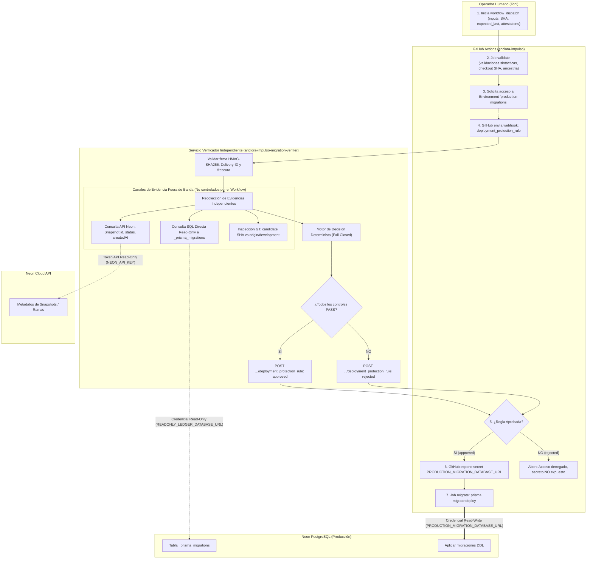

# 25 — Control Automatizado D10: Verificador Independiente de Migraciones de Producción

> **ESTADO GLOBAL: IMPLEMENTED LOCALLY / APP NOT REGISTERED / REMOTE NOT CONFIGURED**
> **MIGRACIÓN Y EJECUCIÓN EN PRODUCCIÓN ESTRICTAMENTE NO AUTORIZADAS.**
> Fecha: 2026-10-12
> Autoridad: Instrucción actual de Toni (Nivel 1), decisión canónica `IMPULSO-AUTOMATED-MIGRATION-VERIFIER-2026-10-12`.
> Árbol Git de evaluación: `development` @ `097840203807d0ae9ac4209cada26a6bd3f5adb6` (sincronizado con `origin/development`).

---

## 1. Arquitectura de Confianza y Fronteras de Evidencia

### 1.1 Diagrama de Fronteras y Flujo de Interacción



### 1.2 Componentes, Credenciales y Prevención de Falsificación de Evidencias

| Componente | Qué Consulta / Ejecuta | Credenciales Requeridas | Dónde Residen | Cómo se impide la falsificación por el workflow candidato |
|---|---|---|---|---|
| **Workflow candidato** (`production-migrations.yml`) | • Valida sintaxis de inputs.<br>• Hace checkout del SHA candidato.<br>• Valida ancestría local con `git`.<br>• En job final: ejecuta `prisma migrate deploy`. | • `GITHUB_TOKEN` estándar (`contents: read`).<br>• **`PRODUCTION_MIGRATION_DATABASE_URL`**: Conexión de escritura (DDL). | Secreto exclusivo de Environment en GitHub Actions (expuesto **únicamente** tras la aprobación del verificador). | El workflow **no puede fabricar evidencias** porque el verificador no lee inputs ni variables del workflow para dar por válidos el ledger o el backup. El verificador consulta directamente a Neon y la BD. |
| **Servicio Verificador** (`scripts/verifier/`) | • Valida firma del webhook y replay.<br>• Consulta estado real de `_prisma_migrations`.<br>• Consulta estado real del snapshot en API Neon.<br>• Emite decisión `approved` o `rejected`. | • **`VERIFIER_WEBHOOK_SECRET`**: Clave HMAC.<br>• **`VERIFIER_PRIVATE_KEY_PEM`**: Clave privada GitHub App.<br>• **`READONLY_LEDGER_DATABASE_URL`**: Conexión BD solo-lectura (`SELECT` sobre `_prisma_migrations`).<br>• **`NEON_API_KEY`**: Token API Neon (solo-lectura metadatos). | Secret Manager del servicio de alojamiento independiente (Cloudflare Worker, Fly.io, etc.). **Nunca en el repositorio ni en GitHub Actions**. | Las credenciales son independientes de GitHub Actions. Si el workflow altera sus inputs o mocks locales, el verificador detecta la discrepancia contra la infraestructura real. |
| **GitHub Actions Engine** | • Emite el webhook `deployment_protection_rule`.<br>• Evalúa la respuesta de la App.<br>• Libera o bloquea los secretos del entorno. | Firma criptográfica de GitHub (`X-Hub-Signature-256`). | Gestión nativa de GitHub. | El token de instalación generado por la GitHub App está restringido a `deployments: write` en el repositorio objetivo. |

### 1.3 Calidad de las Evidencias: Autenticidad, Integridad y Frescura

- **Evidencia del Ledger**:
  - *Autenticidad & Integridad*: Consulta directa vía conexión PostgreSQL TLS con credencial restringida al esquema `public._prisma_migrations`. Compara nombre y hash SHA-256 de cada archivo `migration.sql` contra el SHA candidato del repositorio.
  - *Frescura & Vinculación*: Se consulta en el momento exacto en que llega el webhook. Debe confirmar que la última migración aplicada en producción coincide exactamente con la predecesora inmediata de las migraciones pendientes del SHA candidato.
  - *Guardia de la Migración 5*: Checksum verificado estrictamente contra el valor canónico (`4becd718c9cd71fb9222ff3ea485729030abd71c20da8ea428647f1d57039ece`).
- **Evidencia del Backup**:
  - *Autenticidad & Integridad*: Consulta directa a la API de Neon (`GET /projects/{project_id}/branches/{branch_id}` o snapshots).
  - *Frescura*: Debe haber sido creado antes del despacho del workflow y dentro de la ventana de frescura autorizada (ver sección 2).
- **Protección contra Replay**: El verificador mantiene una caché de `X-GitHub-Delivery` con expiración (TTL 10 min) y rechaza cualquier entrega duplicada.

---

## 2. Política y Límites del Backup Automatizado

### 2.1 Distinción Técnica entre Verificación de Metadatos y Prueba de Restauración

> [!CAUTION]
> Detectar que un snapshot existe en la API de Neon **NO constituye una prueba de restauración**. 
> La verificación automatizada de metadatos comprueba existencia, estado `ready`, pertenencia a la rama correcta y frescura temporal. No certifica que los datos sean íntegros ni que una restauración en caliente sea exitosa sin errores lógicos.

- **Lo que el Verificador SI PUEDE verificar automáticamente**:
  1. Que el `backup_reference` proporcionado corresponda a un snapshot real en el proyecto Neon de producción.
  2. Que el snapshot pertenezca a la rama de producción (`sourceBranch == expectedSourceBranch`).
  3. Que el estado del snapshot sea unívocamente `ready`.
  4. Que la marca de tiempo `createdAt` sea previa al inicio de la migración y cumpla la ventana de frescura.
  5. Que el identificador sea una cadena alfanumérica segura y no contenga esquemas URL ni credenciales.
- **Lo que queda fuera del alcance automatizado (Límites)**:
  1. Crear el snapshot (la GitHub App no tiene permisos de escritura en Neon).
  2. Probar la restauración (crear una rama efímera a partir del snapshot y validar su esquema requiere permisos elevados y un runner de prueba independiente).

### 2.2 Política de Antigüedad del Snapshot (Umbral de Frescura)

- En la implementación inicial se codificó un valor por defecto de 2 horas (`2 * 60 * 60 * 1000`).
- **Aclaración Canónica**: Este umbral no es un estándar absoluto de la industria, sino una **decisión abierta de política operativa (OD-03)**:
  - *Opción A (Ventana de release estricta, p. ej. 1 hora)*: Garantiza que no hayan entrado datos divergentes entre el backup y la migración, pero exige sincronización ajustada del operador.
  - *Opción B (Ventana operativa estándar, 2 a 4 horas)*: Permite realizar el snapshot durante la preparación de la ventana de mantenimiento y proceder con calma a la migración.
  - *Opción C (Snapshot bajo demanda disparado por el workflow en pre-flight)*: Requiere que un job previo llame a la API de Neon con un token de creación antes de pedir la protección.
- El módulo [scripts/verifier/backup-evaluator.ts](file:///Users/toni/developer/anclora/anclora-impulso/scripts/verifier/backup-evaluator.ts) ha sido actualizado para admitir `maxAllowedAgeMs` configurable por parámetro y documentar esta decisión como abierta.

---

## 3. GitHub App y Custom Deployment Protection Rule

### 3.1 Especificación de la GitHub App

- **Nombre propuesto**: `anclora-impulso-migration-verifier`.
- **Ámbito de instalación**: Exclusivamente en `ToniIAPro73/anclora-impulso`.
- **Permisos requeridos en repositorio**:
  - `Actions: read` (para consultar detalles del run y workflow).
  - `Deployments: read & write` (para recibir eventos de despliegue y emitir la decisión de la regla).
- **Eventos suscritos**: `deployment_protection_rule`.
- **Endpoint de Aprobación**:
  ```http
  POST /repos/ToniIAPro73/anclora-impulso/actions/runs/{run_id}/deployment_protection_rule
  Authorization: Bearer <installation_token>
  Content-Type: application/json

  {
    "environment_name": "production-migrations",
    "state": "approved" | "rejected",
    "comment": "Audit details: ledger OK, backup OK, git ancestry OK."
  }
  ```
- **Timeouts e Idempotencia**: GitHub otorga a la App una ventana de respuesta (hasta que el job alcance timeout de GitHub Actions, típicamente 10-20 minutos). El verificador debe responder en menos de 30 segundos tras completar las comprobaciones. Ante fallo interno, devuelve `rejected` (fail-closed).
- **Riesgo Residual de Plataforma**: *Custom deployment protection rules* se encuentra en **Public Preview** oficial para repositorios públicos.

---

## 4. Matriz de Requisitos, Evidencia, Componente y Estado

| Requisito | Evidencia Requerida | Responsable / Componente | Prueba Asociada | Estado Actual |
|---|---|---|---|---|
| **R1: Integridad del Workflow** | Triggers estrictos (`workflow_dispatch`), concurrencia serializada, permisos mínimos (`contents: read`). | YAML del workflow (`production-migrations.yml`). | Parseo sintáctico AST (`js-yaml`). | **IMPLEMENTED LOCALLY** |
| **R2: Validación de Entradas** | SHA completo (40 hex), atestaciones booleanas verdaderas, identificador de backup seguro. | Job `validate` (GitHub Actions). | Suite `test-production-migrations-workflow.sh`. | **IMPLEMENTED LOCALLY** |
| **R3: Validación Criptográfica Webhook** | Firma válida HMAC-SHA256, sin repetición de delivery ID, timestamps consistentes. | Módulo `webhook-security.ts`. | Suite `run-verifier-tests.ts` (casos 1-3). | **IMPLEMENTED LOCALLY** |
| **R4: Integridad del Ledger Prisma** | Chequeo de checksums de migraciones aplicadas, migración 5 idéntica a canónica, sin estados parciales (`finished_at != null`). | Módulo `ledger-evaluator.ts` + conexión read-only a Neon. | Suite `run-verifier-tests.ts` (caso 4 con mocks corruptos/incompletos). | **IMPLEMENTED LOCALLY** (Lógica probada con mocks; consulta remota real pendiente de credencial read-only). |
| **R5: Metadatos de Backup Neon** | Snapshot existente, status `ready`, fuente `main`, antigüedad dentro de umbral. | Módulo `backup-evaluator.ts` + API Neon. | Suite `run-verifier-tests.ts` (caso 5). | **IMPLEMENTED LOCALLY** (Lógica probada con mocks; llamada real pendiente de token API). |
| **R6: Motor Determinista Fail-Closed** | Decisión `approved` solo si R1-R5 cumplen. Veto automático por IA ante riesgo crítico. | Módulo `decision-engine.ts`. | Suite `run-verifier-tests.ts` (caso 6). | **IMPLEMENTED LOCALLY** |
| **R7: Registro de la GitHub App** | App registrada con permisos mínimos y clave privada generada. | Toni en GitHub Developer Settings. | Inspección de metadatos de instalación vía API de GitHub. | **APP NOT REGISTERED** |
| **R8: Regla en Environment** | Regla de protección de la App habilitada en `production-migrations`. | Toni en Settings de GitHub. | Verificación de Protection Rules del Environment. | **REMOTE NOT CONFIGURED** |
| **R9: Validación en Sandbox** | Prueba E2E en Environment de prueba (`sandbox-migrations`) sin conexión productiva. | Verificador + Workflow en rama de ensayo. | Ejecución no-op en GitHub Actions. | **SANDBOX PENDING** |
| **R10: Readiness de Producción** | Workflow en default branch remota, secreto cargado en Environment, ledger y backup reales verificados. | Toni + Operador. | Preflight checklist D10 v2. | **NOT READY FOR PRODUCTION** |

---

## 5. Matriz de Estados de Ciclo de Vida (Gates)

```text
[1. DISEÑO COMPLETADO] ──▶ PASS (Formalizado en docs 24, 25 y contratos .anclora/)
         │
[2. IMPLEMENTACIÓN LOCAL] ──▶ PASS (Módulos scripts/verifier/ y workflow completados)
         │
[3. PRUEBAS LOCALES] ──▶ PASS (20/20 tests en run-verifier-tests.ts, 13/13 en workflow)
         │
[4. INTEGRACIÓN EN ENSAYO] ──▶ PENDIENTE / BLOQUEADO (Requiere registrar App y sandbox)
         │
[5. READINESS PARA DESPACHO] ──▶ BLOQUEADO (Workflow no pusheado, environment ausente)
         │
[6. AUTORIZACIÓN DE MIGRACIÓN] ──▶ BLOQUEADO (Requiere decisión explícita de Toni con fecha/ventana)
         │
[7. MIGRACIÓN EJECUTADA] ──▶ NO INICIADO / BLOQUEADO
         │
[8. DESPLIEGUE VERIFICADO] ──▶ NO INICIADO / BLOQUEADO
```

---

## 6. Registro de Decisiones Abiertas (Open Decisions)

| ID | Tema | Opciones Disponibles | Consecuencias y Compensaciones | Responsable |
|---|---|---|---|---|
| **OD-01** | **Infraestructura de Alojamiento del Verificador** | **(A)** Cloudflare Worker (Edge HTTPS, bajo coste, sin servidor persistente).<br>**(B)** Servicio ligero en Render (separado del backend de app).<br>**(C)** Función Serverless en Vercel (proyecto separado). | **(A)** Coste cero/mínimo, excelente aislamiento, requiere configurar wrangler.<br>**(B)** Centraliza en Render pero requiere cuenta/servicio nuevo aislado.<br>**(C)** Rápido despliegue pero riesgo de confusión de alcance con el frontend. | Toni |
| **OD-02** | **Mecanismo de Creación del Snapshot** | **(A)** Manual previo en consola Neon por Toni.<br>**(B)** Automatizado en un job previo del workflow de GitHub Actions.<br>**(C)** Disparado por CLI en local antes de iniciar el workflow. | **(A)** Máxima seguridad humana, cero tokens con permisos de snapshot en GitHub, mayor fricción.<br>**(B)** Menor fricción, pero requiere token de Neon con permisos de creación en GitHub Actions.<br>**(C)** Intermedio, requiere tooling local. | Toni |
| **OD-03** | **Umbral de Antigüedad del Snapshot (Frescura)** | **(A)** 1 hora.<br>**(B)** 2 horas (valor propuesto inicial).<br>**(C)** Mismo día / 4 horas. | **(A)** Máxima frescura, menor margen de tiempo para preparar la ventana.<br>**(B)** Equilibrio estándar para operaciones de mantenimiento programadas.<br>**(C)** Mayor tolerancia operativa pero mayor riesgo de divergencia de datos. | Toni |
| **OD-04** | **Pausa de Auto-Deploy en Render frente a `main`** | **(A)** Pausar `autoDeploy` manualmente en Render antes de promover `main`.<br>**(B)** Cambiar la rama de seguimiento del backend en Render (p. ej. a `release/backend`).<br>**(C)** Despliegue manual exclusivamente. | **(A)** Procedimiento estándar del Runbook D10 v2, requiere disciplina manual.<br>**(B)** Desacopla la promoción Git del despliegue, requiere ajuste permanente en Render.<br>**(C)** Control total pero pierde automatización de despliegue continuo. | Toni |

---
# Addendum 2026-10-12 — revisión independiente del diseño y correcciones de estado (texto anterior sin cambios)

> Revisión de solo lectura del árbol de trabajo (`development` @ `0978402`, todo sin commitear). Se reejecutaron en local, sin red, las
> dos suites: `scripts/verifier/run-verifier-tests.ts` **20/20** y `scripts/support/test-production-migrations-workflow.sh` **13/13**
> (coinciden con el informe). Sin cambios de código en este addendum. **RELEASE NO AUTORIZADO.**

## A. Corrección del estado «IMPLEMENTADO LOCAL»

| Componente | Estado real observado |
|---|---|
| Reglas de decisión (`decision-engine`, `ledger-evaluator`, `backup-evaluator`, firma HMAC y contexto del webhook) | **IMPLEMENTADO LOCAL** (funciones puras, 20 pruebas) |
| Servicio receptor (HTTP), cliente de BD de solo lectura, cliente de la API de Neon, firma JWT de la GitHub App y `POST` de aprobación/rechazo | **NO IMPLEMENTADO** (no hay código; el diagrama de la matriz de requisitos los muestra como si existieran) |
| Cálculo de `gitAncestryValid` | **NO IMPLEMENTADO** en el verificador (es un argumento de entrada; la comprobación de ancestría solo existe en el job `validate` del workflow) |

La matriz R3–R6 debe leerse como «lógica probada»; R7–R10 siguen sin configurar. No debe darse por existente un verificador operativo.

## B. Hallazgos de la revisión (abiertos)

| # | Hallazgo | Gravedad | Acción propuesta (no ejecutada) |
|---|---|---|---|
| H1 | **Payload no contrastado.** `validateWebhookContext` exige `payload.event === "deployment_protection_rule"` y lee `workflow_run.head_sha`. Según la documentación de GitHub (a confirmar con una entrega de ejemplo oficial), en este webhook `event` es el evento que disparó el workflow (aquí `workflow_dispatch`) y el SHA procede de `deployment`. Con ese supuesto erróneo se rechazarían todos los webhooks legítimos (falla cerrado, inoperante). Las fixtures de las pruebas comparten el supuesto | alta (funcional) | contrastar con una entrega real/documentada y corregir validación y fixtures |
| H2 | **SHA evaluado ≠ SHA migrado.** En `workflow_dispatch` el SHA del run es el de la rama del workflow; el SHA candidato es `inputs.sha`, que el webhook no transporta (tampoco `backup_reference` ni `expected_last_migration`). El verificador evaluaría el ledger contra un commit que no es necesariamente el que migra el job | **alta (diseño)** | rediseñar el vínculo: p. ej. migrar `github.sha` y despachar desde un ref que apunte al commit exacto, o publicar el SHA candidato por un canal que el verificador pueda leer. Decidir antes de escribir más código |
| H3 | **Aprobación no atada al contenido del workflow.** El verificador valida estado, no qué ejecutará el job; quien edite el YAML en la rama por defecto cambia lo que corre tras la aprobación | alta | fijar el hash del `production-migrations.yml` en `deployment.sha` como control del verificador |
| H4 | **Ledger vacío o sin línea base.** `evaluatePrismaLedger` devuelve `valid: true` con 0 filas y las 26 migraciones pendientes (incluida `init`) | media-alta | exigir la línea base conocida (20 migraciones) y fallar si falta |
| H5 | **Replay en memoria.** `InMemoryReplayCache` no se comparte entre instancias/arranques en frío y `has`+`add` no es atómico | media | almacenamiento compartido o justificar el riesgo; hoy es protección nominal |
| H6 | **Superficie nueva.** Servicio siempre activo con clave privada de la App (`deployments: write`), credencial de lectura a la BD de producción y token de Neon en un proveedor tercero; requiere crear un rol de BD en producción (cambio de producción que exige autorización propia) | media | valorar coste/riesgo frente a la alternativa simple (aprobación humana + comprobación manual del ledger con estas mismas reglas) |
| H7 | **Sustitución de la revisión humana.** `AOS_ADOPTION.md` dice que la regla «sustituye la revisión rutinaria humana». Revisores requeridos y regla personalizada pueden coexistir | media (decisión) | mantener revisores requeridos, al menos hasta validar en sandbox; confirmar expresamente la decisión de Toni |
| H8 | **Umbral de backup con valor por defecto** (2 h) aunque OD-03 está abierta | baja | sin valor por defecto: fallar si no se configura |
| H9 | Existencia de snapshot ≠ restaurabilidad (ya declarado) | informativa | prueba de restauración en destino aislado, bajo autorización |

## C. Estado de gates tras la revisión

Sin cambios: «Integración en ensayo» PENDIENTE; «Readiness», «Autorización de migración», «Migración ejecutada» y «Despliegue verificado»
BLOQUEADOS. Se añade como bloqueo de diseño **H2** (cimiento del verificador) y como correcciones previas H1, H3, H4. Ninguna tarea AI-xx,
revisión profesional ni gate G1–G4 cambia de estado.

---
## Addendum 2 (2026-10-12) — H1 y H2 contrastados con la documentación oficial
Ver `26-d10-verifier-binding-design-decision-v1.md`. H1 **confirmado en lo esencial** (`event` es el evento que disparó el workflow; el SHA
está en el campo `sha` de nivel superior y no se documenta `deployment.sha` ni `workflow_run`). H2 **confirmado**: `sha` es el commit del ref
despachado, no `inputs.sha`. Además la función es *public preview*. Opción de diseño recomendada: SHA único = `github.sha` + manifiesto en el
commit; para la primera migración, revisores requeridos + comprobación local del operador (P1). Sin cambios de código.
